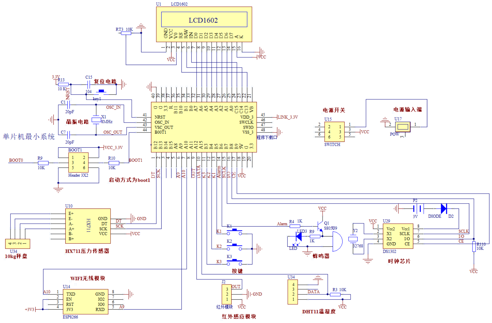
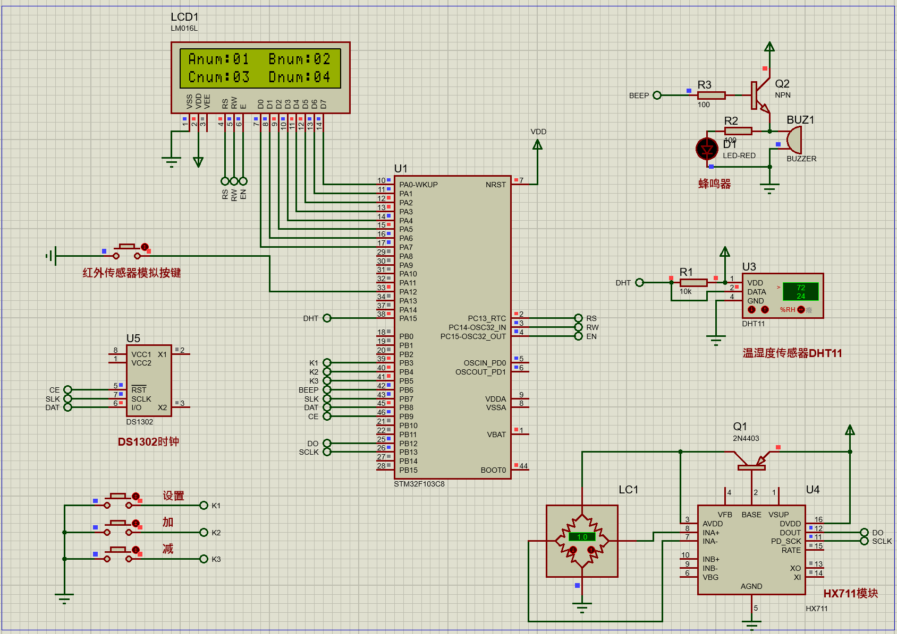

# 基于 STM32 的智能药盒（服药提醒与药量监测）

> 机械电子工程毕业设计 · STM32F103C8T6 · 嵌入式硬件联调与测试
>
> 面向家庭多人服药场景：解决「忘记吃、吃重复、余量不知道」的问题。



---

## 功能一览

| 模块 | 实现 | 说明 |
| --- | --- | --- |
| 药量检测 | HX711 + 10kg 称盘 | 四路药仓余量称重，去皮 + 标定 + 滤波 |
| 环境监测 | DHT11 | 存放环境温湿度，单总线 |
| 时间基准 | DS1302 + 3V 电池 | 掉电走时，服药提醒的基准时钟 |
| 显示 | LCD1602（8 位并口） | 药量、时间与状态提示 |
| 人机交互 | K1 / K2 / K3 | 设置 / 加 / 减 |
| 开盒检测 | 红外感应模块 | DOUT 输入，检测取药动作 |
| 提醒 | 蜂鸣器 + LED（S8050 驱动） | 到点声光提醒 |
| 通信 | ESP8266-01S | AP 模式 TCP 服务器，与手机 APP 收发数据 |
| 主控 | STM32F103C8T6 | 8MHz 晶振 + 复位电路 + BOOT0 跳线 |

## 仿真验证

| 四仓药量计数 | 服药时间设置 |
| --- | --- |
|  |  |

仿真中可完整走通：上电初始化 → 四仓称重显示 → 按键进入时间设置 → 到点声光提醒。

## 关键实现

### 1. HX711 24 位差分采样与去皮标定

`DOUT` 拉低表示本次转换完成，随后给 24 个 `SCK` 脉冲逐位读取，读出后异或 `0x800000` 做符号修正。
每次测量前重读一次零点实现去皮，净重 = 当前值 − 零点。

```c
unsigned long ReadCount(void)
{
    u32 Count = 0;
    u8 i;
    ADSK = 0;
    while (ADDO);                 // 等待转换完成
    for (i = 0; i < 24; i++) {
        ADSK = 1;
        Count = Count << 1;
        delay_us(1);
        ADSK = 0;
        if (ADDO) Count++;
        delay_us(1);
    }
    ADSK = 1;
    Count = Count ^ 0x800000;     // 符号修正
    delay_us(1);
    ADSK = 0;
    delay_us(1);
    return Count;
}
```

24 位 ADC 对微小变化极敏感，因此加了「阈值判微动 → 按百位取整 → 滑动滤波」三步，避免空仓读数乱跳；
量程系数 `RATIO 0.00480` 由已知质量砝码标定得出。

### 2. DHT11 单总线时序

主机拉低 ≥18ms 发起起始信号，释放后等待 40–50us 应答；每一位延时 40us 后采样判 0/1，再等 116–118us 高电平结束。
**每段等待都设了超时计数**，传感器无响应时直接返回失败，主循环不会卡死。

### 3. DS1302 三线接口

`CE` 拉高后按位发送命令与数据，`SCLK` 上升沿锁存；主电源掉落后由纽扣电池维持走时，上电后读取当前时间而非重置。

### 4. ESP8266 AT 指令流程

```c
AT                     // 测通
AT+CWMODE=2            // 模块自建热点
AT+CWSAP="ESP8266_WIFI","12345678",5,3
AT+CIPMUX=1            // 多连接
AT+CIPSERVER=1,8080    // 建服务器
```

发送数据前先发 `AT+CIPSEND` 并等待 `>` 提示符再发内容，避免指令与数据粘连；接收侧解析 `+IPD` 头取出有效载荷。

## 目录结构

```
.
├── assets/                  # 原理图、仿真截图
├── docs/                    # 技术作品集 PDF
├── src/
│   ├── Driver/              # 外设驱动：hx711 / dht11 / ds1302 / lcd1602 / esp8266 / timer / gpio
│   └── User/                # main.c、中断与系统时钟
└── README.md
```

## 我的工作

主控程序基于现有工程二次开发，本人负责：

- 硬件层联调：接线、供电、共地核查，逐个模块单独验证通信
- 驱动参数标定：砝码标定量程系数、零点去皮、滤波参数调整
- 通信配置：ESP8266 AP 模式与 TCP 服务器配置、AT+CIPSEND 握手
- 仿真与测试：Proteus 整机仿真验证、实物功能测试与记录

## 作品集

完整的技术作品集见 [`docs/王杰-技术作品集.pdf`](docs/王杰-技术作品集.pdf)。
